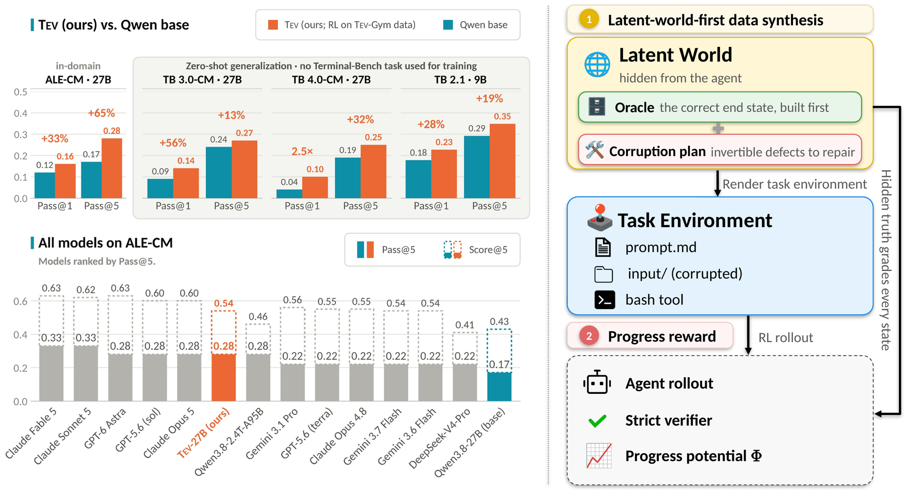
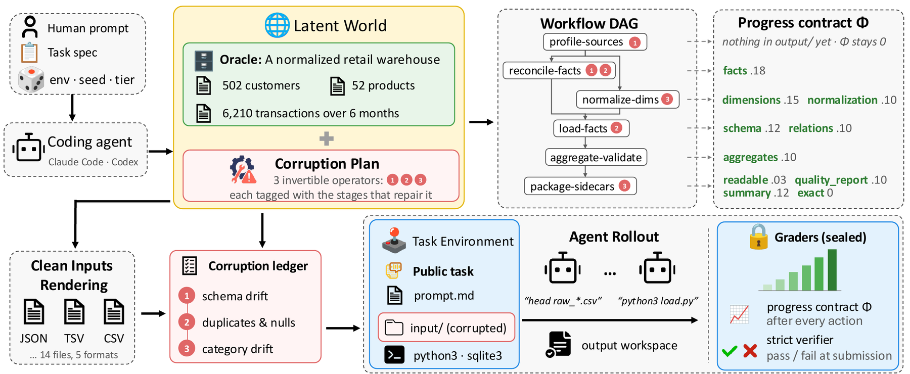
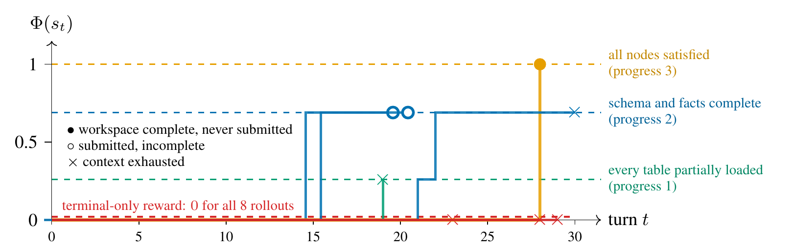

<h1 align="center">Tev: Scaling Long-Horizon Agentic Environments<br>with Dense Progress Rewards</h1>

<p align="center">
Wenbo Hu<sup>1,2</sup>, Shraman Pramanick<sup>1</sup>, Krishna Kumar Singh<sup>1</sup>,
Nanyun Peng<sup>2</sup>, Kai-Wei Chang<sup>2</sup>, Yong Jae Lee<sup>1</sup><br>
<sup>1</sup>Adobe Research &nbsp;&nbsp; <sup>2</sup>University of California, Los Angeles
</p>

<p align="center">
<a href="https://arxiv.org/abs/2610.18868">📄 Paper</a> &nbsp;·&nbsp;
<a href="https://tev-agent.github.io/">🌐 Website &amp; Demo</a> &nbsp;·&nbsp;
<a href="https://huggingface.co/gordonhu/Tev-27B">🤗 Tev-27B</a> &nbsp;·&nbsp;
<a href="https://huggingface.co/gordonhu/Tev-320B">🤗 Tev-320B</a> &nbsp;·&nbsp;
<a href="https://x.com/gordonhu608/status/2110400049515728911">𝕏 Thread</a>
</p>

<p align="center"></p>

Open models still struggle with long-horizon agentic tasks, which run from hours to days. The main
reason is that neither the training data nor a working recipe exists. Long, complex tasks are hard to
curate and verify, and their rewards are sparse. This repository contains the training and
evaluation code for **Tev**, which addresses both problems:

- **Latent-world-first synthesis.** Each task is built *backward* from a *latent world*: a complete,
  correct, hidden specification of the task's domain, its workflow as a DAG of stages, and the
  expected state after every stage. The agent-facing files are rendered from that world and then
  corrupted by declared, invertible operators. The latent world is therefore an exact answer key for
  the final result *and* for every intermediate state.
- **Tev-Gym.** The first long-horizon agent training dataset with verifiable, dense, progressive
  rewards: 1,170 verified task environments across 7 computing-and-math domains. A frontier agent
  needs a median of 12.4 minutes per rollout, about 6× longer than on the most time-intensive prior
  corpus.
- **Progress-potential reward shaping (PPRS).** The latent world grades the agent's workspace after
  every turn. This gives a progress potential Φ ∈ [0, 1], which becomes a dense per-turn reward. It
  makes training efficient, and it makes tasks trainable that terminal-only reward cannot train at
  all.
- **Tev-9B / Tev-27B.** These are Qwen3.5-9B and Qwen3.8-27B trained with PPRS on Tev-Gym. On
  **ALE-CM** (the computing-and-math split of Agents' Last Exam), Tev-27B raises Pass@5 by 65% over
  its base, to 0.28, matching GPT-6 Astra and Claude Opus 5. It also transfers to the Terminal-Bench
  3.0 / 4.0 "CM" subsets without any Terminal-Bench training data, where it outperforms GLM 5.2 and
  Gemini 3.7 Flash. On TB 2.1 it reaches 0.794 Pass@1 (Claude Opus 4.8: 0.789).
- **Tev-320B.** This is GLM-5.3-Flash trained with the same recipe. On the Terminal-Bench 3.0 / 4.0 "CM"
  subsets it raises Pass@1 from 0.20 to 0.27 and from 0.29 to 0.37, the strongest open model on both. On
  TB 4.0 only Claude Opus 5, Claude Fable 5 and GPT-5.6 (sol) score higher.

## Contents

- [What is in this repository](#what-is-in-this-repository)
- [Results](#results)
- [Method](#method)
- [Setup](#setup)
- [The example environment](#the-example-environment)
- [Training](#training)
- [Evaluation](#evaluation)
- [Repository layout](#repository-layout)
- [Citation](#citation)
- [License and acknowledgements](#license-and-acknowledgements)

## What is in this repository

| | |
|---|---|
| **Training** | The PPRS + DPPO recipe for the 9B and 27B models (`scripts/train/train_pprs.sh`), on a trimmed fork of [open-instruct](https://github.com/allenai/open-instruct) (Ray + vLLM + DeepSpeed). It includes the dense-reward sandbox env, the host-side grader driver, and per-turn credit assignment. |
| **Evaluation** | One-command launchers for ALE-CM (18 tasks), the Terminal-Bench 4.0 CM subset (18 tasks), and Terminal-Bench 2.1 (89 tasks), with the harnesses, presets and pass@k scoring we used. |
| **A worked Tev-Gym environment** | One complete training environment (the retail-warehouse ETL task of Figure 3 in the paper), in the exact dataset format the trainer reads. It comes with the exact grader code that computes its progress potential and terminal reward. |

## Results

**ALE-CM** (18 long-horizon tasks from Agents' Last Exam, 5 rollouts per task). The table reports the
mean graded score (S@1), the fraction of rollouts that fully solve the task (P@1), and their best-of-5
counterparts. Every Qwen model, base or trained, runs in the Vanillux2 harness. Frontier models run in
their native harnesses. Per-category results are in Table 2 of the paper.

| Model | Harness | S@1 | S@5 | P@1 | P@5 |
|---|---|:-:|:-:|:-:|:-:|
| GPT-6 Astra | Codex | 0.62 | 0.63 | 0.28 | 0.28 |
| Claude Fable 5 | Claude Code | 0.58 | 0.63 | 0.29 | 0.33 |
| Claude Opus 5 | Claude Code | 0.58 | 0.60 | 0.28 | 0.28 |
| Qwen3.8-2.4T-A95B | Vanillux2 | 0.32 | 0.46 | 0.14 | 0.28 |
| Qwen3.5-9B (base) | Vanillux2 | 0.25 | 0.33 | 0.06 | 0.06 |
| **Tev-9B** | Vanillux2 | **0.29** | **0.40** | **0.07** | **0.11** |
| Qwen3.8-27B (base) | Vanillux2 | 0.33 | 0.43 | 0.12 | 0.17 |
| **Tev-27B** | Vanillux2 | **0.40** | **0.54** | **0.16** | **0.28** |

**Terminal-Bench 3.0 / 4.0, "CM" subsets** (22 / 18 tasks, 5 trials per task; zero-shot, since no
Terminal-Bench task is used for training). Leaderboard rows use the official per-trial results, and
\* marks results we evaluated ourselves. Tev-320B is evaluated on these two subsets only. The full
comparison is in Table 3 of the paper.

| Model | TB 3.0 P@1 | TB 3.0 P@5 | TB 4.0 P@1 | TB 4.0 P@5 |
|---|:-:|:-:|:-:|:-:|
| Claude Opus 5 | 0.53 | 0.64 | 0.52 | 0.72 |
| GLM 5.2 | 0.04 | 0.18 | 0.03\* | 0.13\* |
| Qwen3.8-27B (base) | 0.09 | 0.24 | 0.04 | 0.19 |
| **Tev-27B** | **0.14** | **0.27** | **0.10** | **0.25** |
| GLM-5.3-Flash (base) | 0.20 | 0.50 | 0.29 | 0.56 |
| **Tev-320B** | **0.27** | **0.55** | **0.37** | **0.56** |

**Terminal-Bench 2.1** (89 tasks, 5 trials; zero-shot). Tev-9B runs in Vanillux2 and Tev-27B in
Terminus-2. Frontier rows are from the official leaderboard.

| Model | Pass@1 | Pass@5 |
|---|:-:|:-:|
| Opus 4.8 (Claude Code, high) | 0.789 | 0.944 |
| Qwen3.5-9B (base) | 0.178 | 0.292 |
| **Tev-9B** | **0.227** | **0.348** |
| Qwen3.8-27B (base) | 0.764 | 0.864 |
| **Tev-27B** | **0.794** | **0.884** |

## Method

<p align="center"></p>

**Latent-world-first synthesis.** Each Tev-Gym environment comes from a seeded generator program,
built as follows:

- **Build the world.** Given a seed and a scale tier (*unit*, *small* or *full*), the generator first
  builds the latent world W, for example a retail warehouse's customers, products and transactions.
  It also draws a *defect plan*.
- **Compile the workflow.** The generator compiles the task's workflow into a DAG of stages, such as
  `profile-sources → reconcile-facts / normalize-dimensions → load-facts → aggregate-validate →
  package-sidecars`.
- **Render and corrupt.** It renders W into the agent's input files (CSV, TSV, JSON, SQLite, …),
  checks that the rendering round-trips, and applies the declared, invertible corruptions (schema
  drift, duplicates and nulls, category drift, …).
- **Seal the grading package.** The prompt, the corrupted input tree, the strict verifier and the
  progress potential are all functions of the same W. They are sealed into a grading package that
  never enters the agent's sandbox.

Every environment passes eight qualification gates. These include exploit resistance (all 14 gaming
probes score 0), progress validity (Φ is strictly between 0 and 1 on partial states and rises
monotonically to 1 along the reference trajectory), and role independence (the progress scorer,
verifier and reference solvers have disjoint code).

**The progress potential.** Every environment has a *progress contract*: a set of nodes V, derived
from the workflow DAG, each with a weight wᵥ and a set of prerequisites. A partial scorer cᵥ(s) ∈ [0,1]
grades the workspace s on node v against the latent world. Credit is prerequisite-gated: c̃ᵥ(s) is the
lowest score among v and all its prerequisites. The potential is

$$\Phi(s) = \sum_{v \in V} w_v\, \tilde c_v(s) \in [0, 1].$$

**PPRS.** The per-turn reward is the change in potential, rₜ = Φ(sₜ) − Φ(sₜ₋₁). The rollout reward is

$$R(\tau) = \mathbb{1}[\tau \text{ passes}] + \lambda \sum_{t=1}^{T} r_t = \mathbb{1}[\tau \text{ passes}] + \lambda\, \Phi(s_T), \qquad \lambda = 0.25 .$$

Any passing rollout (1 + λ) therefore outscores any failing one (≤ λ). Within a group where *no*
rollout passes, the rewards still differ by how far each rollout progressed, so the group still
produces a gradient. In training, turn t receives λ·rₜ, and the final turn also receives the terminal
reward. Each turn's advantage is its return-to-go Gₜ (γ = 1) minus the group mean of Gₜ over the
rollouts that reached turn t. This per-turn-index baseline is zero-mean at every turn.

<p align="center"></p>
<p align="center"><em>Eight rollouts of Tev-27B on one warehouse environment, graded after every turn. Terminal-only
reward is 0 for all eight. Under Φ, the rewards differ within the group.</em></p>

Where it lives in the code (`training/open-instruct/open_instruct/`):

| Piece | File |
|---|---|
| Sandbox env: one `bash` tool; after every workspace-changing turn, copies `/app/output` out of the container, grades Φₜ on the host and emits λ·(γΦₜ − Φₜ₋₁); grades the terminal reward on submit | `environments/swerl_vanillux_dense_sandbox.py` |
| Host-side grader driver (loads the task's grading package and the grader codebase) | `environments/v72_grader.py` |
| Per-turn returns-to-go, per-turn-index group baseline, scatter onto each turn's tokens | `dense_credit.py` (wired in `data_loader.py` behind `--per_turn_credit`) |
| DPPO loss (`--loss_fn dppo`), Qwen3.5 / 3.8 packed-sequence GatedDeltaNet patch | `grpo_utils.py`, `qwen3_5_packing_patch.py` |

## Setup

- **Training venv**: `cd training/open-instruct && uv sync` (Python 3.12, pinned by `uv.lock`).
  - The grader runs inside this venv. It needs Python ≥ 3.12 and pydantic 2.
  - Qwen3.8-27B needs `transformers==5.10.0`. Newer releases change the GatedDeltaNet module that
    `open_instruct/qwen3_5_packing_patch.py` patches.
  - Blackwell GPUs need a CUDA ≥ 12.8 toolkit on `CUDA_HOME` for FlashInfer's JIT kernels.
- **Docker** on every node, plus the sandbox image. `bash scripts/build_sandbox_image.sh` builds
  `tev-sandbox:latest`, which contains no grader code. For multi-node runs, either push
  it (`PUSH=1 REGISTRY=<your-registry>`) and point the dataset rows at it, or `docker load` it on
  every node.
- **Harbor 0.20.0** for the Terminal-Bench evals: `scripts/eval/setup_harbor21.sh`. `eval_tb21.sh` and
  `eval_tb4_cm.sh` call it for you.
- **Agents' Last Exam** for the ALE-CM eval: `scripts/eval/ale_cm/setup_ale.sh`, which
  `eval_ale_cm.sh` calls for you. It needs `uv`, `hf auth login`, and access to the gated task-data
  dataset
  ([agents-last-exam-data-archive](https://huggingface.co/datasets/agents-last-exam/agents-last-exam-data-archive)).

## The example environment

**Task: `examples/data/warehouse_etl_example/`** (`cm.warehouse-etl.v2`, seed 990201). The agent must
rebuild a star-schema SQLite warehouse from six months of messy retail CSV/TSV/JSON sources and write
two truthful JSON sidecars (a data-quality report and a warehouse summary). It is an environment of the
family shown in Figures 3 and 4 of the paper. Its progress contract has the nodes `readable`, `schema`, `dimensions`,
`facts`, `normalization`, `relations`, `aggregates`, `quality_report` and `summary`.

The dataset format:

- `data/train-00000-of-00001.parquet`: one row per task, holding the prompt `messages` (system + user)
  and `env_config {env_name: swerl_vanillux_dense, image: tev-sandbox:latest, task_id}`.
- `task-data/<task_id>/`:
  - `instruction.md`;
  - `environment/seeds/`: the agent's starting workspace, mounted at `/app`. It holds the inputs, a
    README, and an empty `output/` directory that the launcher recreates;
  - `authority/package/`: the task's grading package (the public spec plus the private latent world,
    hidden suite and contracts). Only the host-side grader reads it, and it is never copied into the
    sandbox;
  - `dense_config.json`: `grade_mode: live`, which means shaping after every turn plus a terminal
    score.

A full dataset is simply many such rows and task directories. The launcher also accepts
`task-data.tar.gz` in place of `task-data/`.

**Grader: `examples/grader/training_data_collection/`.** This is the reward function for that task. It
contains the task-contract library (package `v72`, contract schema v7.2), the progress runtime,
package validation, and the `cm.warehouse_etl_recovery` family's progress scorer and strict verifier.
It is 61 files, all unmodified.

- The task package pins a hash of its family's implementation. The grader refuses to load a package
  whose family code differs ("family revision authority is stale").
- **Do not edit `examples/grader`.** Even a comment change breaks the package, and during training such
  tasks silently fall back to terminal-only reward.

To verify that the grader and the dataset match:
```bash
python scripts/check_grader.py --dataset-dir examples/data/warehouse_etl_example --codebase examples/grader
# -> 1/1 task packages load; an empty workspace grades progress 0.0 / terminal 0.0
```
With this grader, the task's reference solution grades Φ = 1.0 and terminal = 1.0. A partial solution
(only the warehouse database) grades Φ = 0.26 and terminal = 0.0. Loading a package normalizes it in
place, as training does: public inputs become read-only, and missing empty directories are recreated.

## Training

Quick start on the one-task example, on a single 8-GPU node:
```bash
bash scripts/build_sandbox_image.sh
SMOKE=1 MODEL_PATH=/path/to/Qwen3.5-9B bash scripts/train/train_pprs.sh
```
`DATASET_DIR` and `V72_CODEBASE` default to the example. Prompts per step are clamped to the number of
tasks, so the example uses 1.

To train on a full dataset, run the same command on every node:
```bash
NUM_NODES=4 NODE_RANK=<0..3> MASTER_ADDR=<node-0 hostname> MODEL_PATH=/path/to/Qwen3.5-9B \
DATASET_DIR=/path/to/data/<dataset> V72_CODEBASE=/path/to/grader_codebase \
OUTPUT_DIR=/path/to/runs/<exp-name> bash scripts/train/train_pprs.sh
```
`V72_CODEBASE` must be the grader revision the task packages were built with. Check it with
`scripts/check_grader.py` before training.

The recipe (paper, Appendix C). The values are the 9B defaults of `train_pprs.sh`:

| Setting | Value |
|---|---|
| Objective | DPPO: group-centered advantages, total-variation bound 0.1 on the policy ratio, no KL (β = 0) |
| Reward | PPRS with λ = 0.25 (the task contract's `shaping_scale`); per-turn credit, return-to-go with γ = 1, per-turn-index group baseline |
| Rollouts | G = 24 per task, 8 tasks per step (192 rollouts per step); zero-variance groups discarded and refilled (active sampling) |
| Budgets | 2,048 prompt tokens; 65,536 response tokens; 16,384 tokens per turn; ≤ 64 tool calls per rollout |
| Optimizer | AdamW, lr 1e-6, constant schedule, one epoch per batch; sampling temperature 1.0; seed 42 |
| Systems | bf16 with fp32 LM head; ZeRO-3 (ZeRO++ partitioning 8), sequence parallelism 4 (9B), async 6, sandbox pool 768 |
| 9B layout | 4 × 8 GPUs = 16 learners + 16 vLLM engines; 9,216 episodes (48 steps) on the 264-task *unit*-tier subset |
| 27B layout | 8 × 8 GPUs = 16 learners + 48 vLLM engines; its overrides (layout, async steps, ZeRO++ partitioning) are in the header of `train_pprs.sh` |

- All paths must be visible at the same location on every node.
- Keep `OUTPUT_DIR/checkpoint_state` on a shared filesystem. Rerunning the same command resumes.
- For tracking, set `WANDB_API_KEY` (and optionally `WANDB_PROJECT`). The dense-reward metrics are
  `val/per_turn_reward_sum_mean`, `val/dense_signal_mean` and `env/swerl_vanillux_dense/*`
  (`progress_potential_final`, `terminal_reward_raw`, `grading_seconds`).

> `MAX_TOOL_CALLS` (grpo `--max_steps`) caps the number of **tool calls per episode**. It does not
> set the number of training steps: training length is `TOTAL_EPISODES / (UNIQ_PROMPTS × SAMPLES)`.

To export a checkpoint for serving:
```bash
# ZeRO checkpoint -> HF (the 9B exports fp32; for 27B use BASE_MODEL_DIR=/path/to/Qwen3.8-27B DTYPE=bf16)
CKPT_DIR=/path/to/runs/<exp-name>/checkpoint_state STEP=48 \
BASE_MODEL_DIR=/path/to/Qwen3.5-9B OUT_DIR=/path/to/hf/<exp-name>-step48 \
  bash scripts/eval/convert_ckpt_to_hf.sh
```
The RL checkpoint holds only the text model, so serve exports with `--language_model_only`. This is the
`LM_ONLY=1` default of every eval launcher, and it also works for the released models.

## Evaluation

Each launcher runs on one 8-GPU node. It serves the model with vLLM (docker), runs the benchmark, and
writes pass@k metrics. `MODEL_PATH` is an HF model directory: a released Tev checkpoint, a base model,
or an export from `convert_ckpt_to_hf.sh`. Rerunning with the same model resumes the job. The serving
presets cover the Qwen-based models (Tev-9B, Tev-27B and their bases). Tev-320B is a GLM-5.3-Flash model,
which these presets do not serve.

### ALE-CM (Agents' Last Exam, computing and math)

These are the 18 computing-and-math tasks of [Agents' Last Exam](https://github.com/rdi-berkeley/agents-last-exam)
that run in a Linux Docker sandbox (`scripts/eval/ale_cm/computing_math.txt`). Each is scored by its
own ALE grader. The model is driven by `vanillux_oai`, the Vanillux2 harness (the training prompts
and single `bash` tool) packaged as an ALE agent. The protocol is 5 independent rollouts, temperature
0.7, top_p 0.95, thinking on, at most 64 turns and 16,384 tokens per turn, and 2 h per task.
```bash
MODEL_PATH=/path/to/Tev-27B bash scripts/eval/ale_cm/eval_ale_cm.sh                  # 27B: DP4 x TP2, 64k context
PRESET=9b MODEL_PATH=/path/to/Tev-9B bash scripts/eval/ale_cm/eval_ale_cm.sh         # 9B: DP8 x TP1
```
- `setup_ale.sh` clones ALE at a pinned revision (`ALE_REF`, the one our numbers use; later revisions
  changed some computing_math tasks). It also installs the agent, builds ALE's venv, fetches the task
  data and pulls the sandbox image. To reuse an existing checkout, point `ALE_DIR` at it.
- `results/ale-cm-<model>/stats.txt` (and `metrics.json`) gives the per-task scores. Over the 18 tasks,
  it also gives pass@1 (mean ± sem over rollouts) and pass@5 (best-of). A task with no result counts
  as 0 and is listed.

### Terminal-Bench 4.0 (CM subset)

These are the 18 Terminal-Bench 4.0 tasks in the computing-and-math domain that the paper evaluates
(`scripts/eval/tb_cm/tb4_cm.txt`). The agent is Terminus-2, with temperature 0.7, top_p 0.95, 32k tokens
per call and thinking on, k = 5. Serving is DP8 × TP1 with a 131k context.
```bash
MODEL_PATH=/path/to/Tev-27B bash scripts/eval/eval_tb4_cm.sh
```
- The task list also contains, commented out, the in-domain tasks the paper leaves out because a
  CPU-only Docker sandbox cannot run and grade them. `math-eval-grader` needs a sandbox GPU: it runs
  only with `INCLUDE_GPU_TASKS=1` and a GPU-capable `HARBOR_ENV`.
- Outputs go to `jobs/tb4-cm-<model>/` and `results/tb4-cm-<model>/`.

### Terminal-Bench 2.1

```bash
MODEL_PATH=/path/to/Tev-9B bash scripts/eval/eval_tb21.sh                # 9B: Vanillux2Agent, DP8 x TP1
PRESET=27b MODEL_PATH=/path/to/Tev-27B bash scripts/eval/eval_tb21.sh    # 27B: Terminus-2, DP4 x TP2
```
- Harbor trials land in `jobs/<JOB_NAME>/`, and pass@k metrics in `results/<JOB_NAME>/metrics.json`.
- The launcher also writes `metrics_clean.json`, the same metrics with infrastructure-failed trials
  (API or serving errors, grader hangs) dropped instead of counted as wrong answers.
- On a rerun, trials that failed for infrastructure reasons are re-queued.

## Repository layout

| Path | What |
|---|---|
| `scripts/train/train_pprs.sh` | The training launcher: the recipe, the multi-node Ray setup, and defaults that point at the example. |
| `scripts/eval/` | TB 2.1 (`eval_tb21.sh`), checkpoint export (`convert_ckpt_to_hf.sh`), vLLM serving, the Harbor runners, and pass@k scoring (`compute_stats*.py`). |
| `scripts/eval/eval_tb4_cm.sh`, `scripts/eval/tb_cm/` | TB 4.0 CM subset: the launcher and the task list. |
| `scripts/eval/ale_cm/` | ALE-CM: `eval_ale_cm.sh` (launcher), `setup_ale.sh`, the `vanillux_oai` ALE agent (Vanillux2), configs, and `summarize_ale_cm.py`. |
| `scripts/build_sandbox_image.sh`, `docker/` | The agent sandbox image (`tev-sandbox:latest`). It contains no grader code. |
| `scripts/check_grader.py` | Checks that a grader codebase matches a dataset (every task package must load and validate). |
| `examples/data/warehouse_etl_example/` | One Tev-Gym training environment, in the dataset format the trainer reads. |
| `examples/grader/` | The grader code (`training_data_collection`) for that environment's family, at the exact revision the task was built with. |
| `training/open-instruct/` | The trainer: a trimmed open-instruct fork (see its `README.md` for the fork changes). |
| `Vanillux2Agent/` | Harbor agent for the 9B TB 2.1 evals: the Vanillux2 harness (the training prompts and single `bash` tool). |
| `assets/` | Figures used in this README. |

## Citation

```bibtex
@misc{hu2026tev,
  title         = {{Tev}: Scaling Long-Horizon Agentic Environments with Dense Progress Rewards},
  author        = {Hu, Wenbo and Pramanick, Shraman and Singh, Krishna Kumar and
                   Peng, Nanyun and Chang, Kai-Wei and Lee, Yong Jae},
  year          = {2026},
  eprint        = {2610.18868},
  archivePrefix = {arXiv}
}
```

## License and acknowledgements

This code is released under the Adobe Research License (`LICENSE`), for non-commercial research use only. The trainer is built on
[open-instruct](https://github.com/allenai/open-instruct) (`training/open-instruct/LICENSE`,
Apache-2.0), and the objective is DPPO ([Qi et al., 2026](https://arxiv.org/abs/2602.04879)). The Vanillux2
harness prompts derive from [mini-SWE-agent](https://github.com/SWE-agent/mini-swe-agent) (MIT) via the
[TMax](https://github.com/hamishivi/tmax) vanillux solver. The evaluations run against [Agents' Last Exam](https://github.com/rdi-berkeley/agents-last-exam)
(Apache-2.0; task data under its own license) and [Terminal-Bench](https://arxiv.org/abs/2601.11868)
through [Harbor](https://pypi.org/project/harbor/). Both are fetched at setup and not vendored here.
